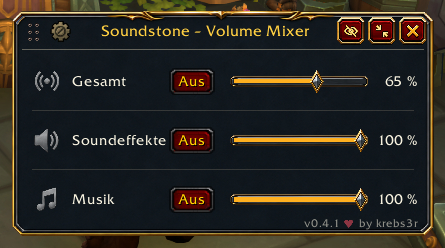
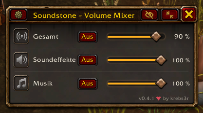
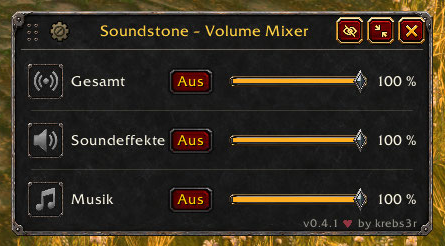
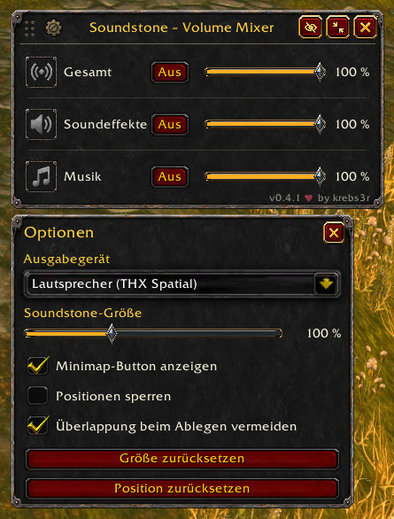
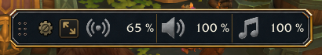
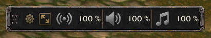
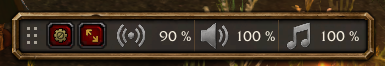

# Soundstone – Azeroth Volume Mixer

**Your game. Your sound.**

Soundstone puts WoW's master volume, sound effects and music on a small bar you can place anywhere on your screen. Click an icon to mute it, scroll over it to turn it up or down, and open the mixer for sliders and your audio output device. It wears your client's own look, from Retail's gold to WoW: Forever's bronze frame.

  

In-game screenshots from Retail, WoW: Forever and TBC Anniversary, German client.

## What it does

- **Three channels on one bar.** Master volume, sound effects and music, each with its icon and value. Click an icon to mute or unmute it; the volume stays where it was.
- **Volume on the mouse wheel.** 5 % per step, 1 % with Shift.
- **The mixer.** Sliders from 0 to 100 % and an On/Off button per channel; Escape takes you back to the bar.
- **Your audio output device.** Switch between speakers and headset from the gear menu, without opening the sound settings.
- **Sensible switching.** A channel turned on at 0 % gets its last volume back. With master volume off, turning on music or sound effects plays just that group.
- **Leaves your settings alone.** Soundstone reads WoW's audio settings and changes nothing when you log in.
- **One download, five clients.** Retail, Mists of Pandaria Classic, TBC Anniversary, Classic Era and WoW: Forever.

The mixer and its options in TBC Anniversary, in-game.

## Options

Click the gear on the bar or in the mixer for the output device, Soundstone's size (75 to 150 %), the minimap button, locked positions and overlap avoidance, which moves a dropped Soundstone to the nearest free spot beside your action bars and frames. Where the client has an Addons menu below the minimap clock, Soundstone opens from there too.

`/soundstone` switches between bar and mixer, `/soundstone music 30` or `/soundstone master off` set a channel, and `/soundstone help` lists the rest. Four optional key bindings wait in WoW's Key Bindings menu.

## Your client's look

Soundstone wears the look of the client it runs in: Retail's gold frame on Retail; iron and stone on Mists Classic, TBC Anniversary and Classic Era. On WoW: Forever it opens in Forever's own bronze window frame, with the client's red buttons, slider and action-button frames. There is nothing to set.

The compact bar in Retail, TBC Anniversary and WoW: Forever, in-game.

## Good to know

- **Sound effects** covers effects, ambience and dialogue together. Voice chat, pet sounds and error speech stay as you set them.
- **Device selection** depends on what your client's audio system offers. Switching restarts WoW's sound once, as the sound settings do.
- **Hidden it?** `/soundstone show` brings it back.
- English and German. No other addons needed.

From the same author: [Buttonstone – Azeroth Minimap Buttons](https://www.curseforge.com/wow/addons/buttonstone-azeroth-minimap-buttons), [Hourstone – Azeroth Playtime Tracker](https://www.curseforge.com/wow/addons/hourstone-azeroth-hours) and [Umbra Unit Frames](https://www.curseforge.com/wow/addons/umbra-unit-frames). Source, German guide and issues: [GitHub](https://github.com/krebs3r/soundstone-azeroth-audio). Soundstone's artwork includes AI-generated source art; its provenance is documented in the repository.

---

## Deutsch

**Dein Spiel. Dein Sound.**

Soundstone legt Gesamtlautstärke, Soundeffekte und Musik auf eine kleine Leiste, die du frei platzierst. Ein Klick aufs Icon schaltet stumm, das Mausrad regelt lauter und leiser, und der Mixer bringt Schieberegler und dein Ausgabegerät dazu. Dabei trägt Soundstone den Look deines Clients, vom Gold in Retail bis zum Bronzerahmen in WoW: Forever.

- **Drei Kanäle auf einer Leiste:** Klick aufs Icon schaltet stumm, die Lautstärke bleibt erhalten. Mausrad 5 %, mit Umschalt 1 %.
- **Mixer** mit Schiebereglern und An/Aus je Kanal; Escape führt zurück zur Leiste.
- **Ausgabegerät** wechseln, etwa vom Lautsprecher zum Headset, direkt im Zahnrad-Menü.
- **Lässt deine Einstellungen in Ruhe:** Soundstone liest WoWs Audioeinstellungen und ändert beim Einloggen nichts.
- **Ein Download, fünf Clients:** Retail, Mists of Pandaria Classic, TBC Anniversary, Classic Era und WoW: Forever.

Optionen über das Zahnrad: Ausgabegerät, Größe, Minimap-Button, Positionen sperren und Überlappung vermeiden. `/soundstone` wechselt zwischen Leiste und Mixer, `/soundstone help` zeigt alle Befehle.
